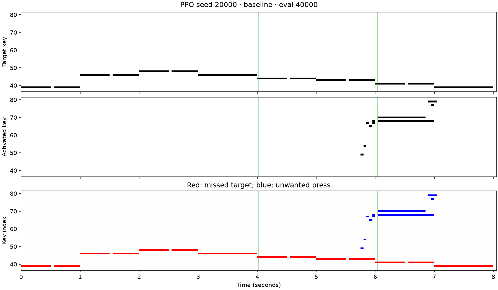
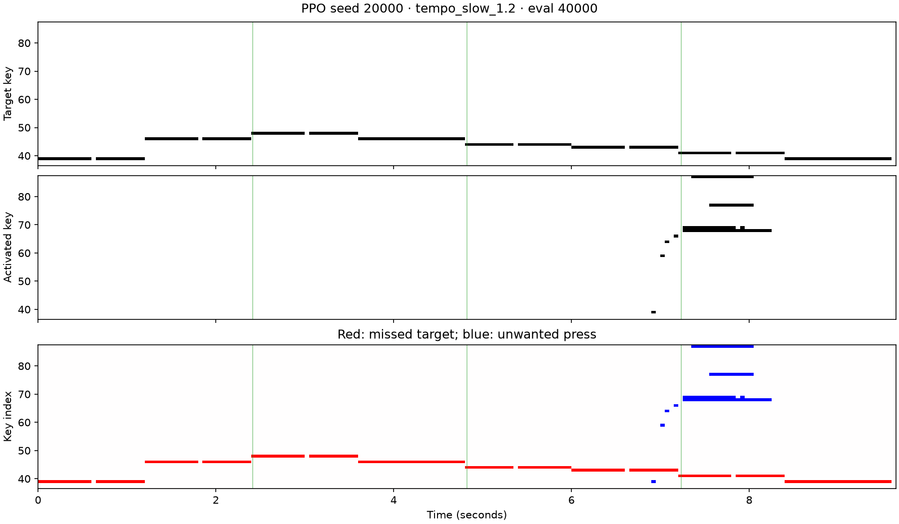
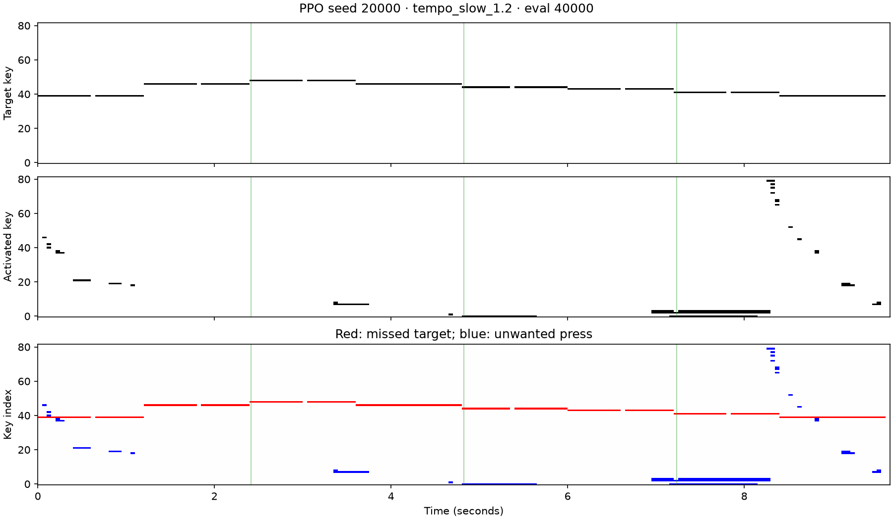
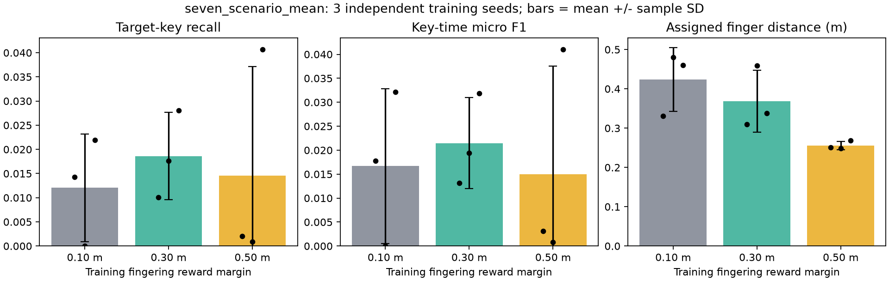
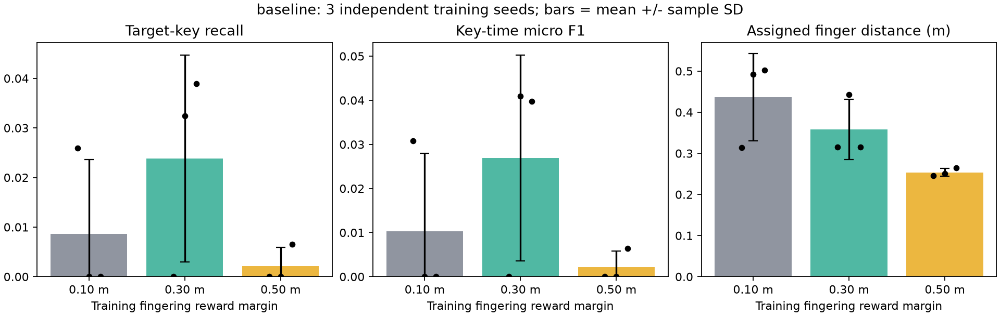
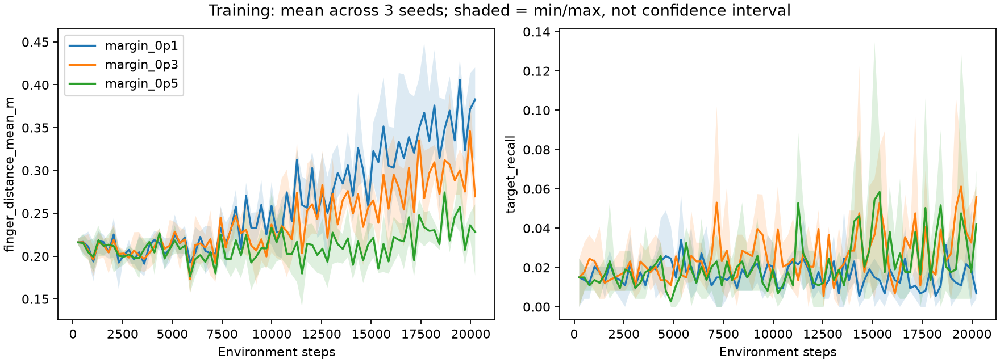
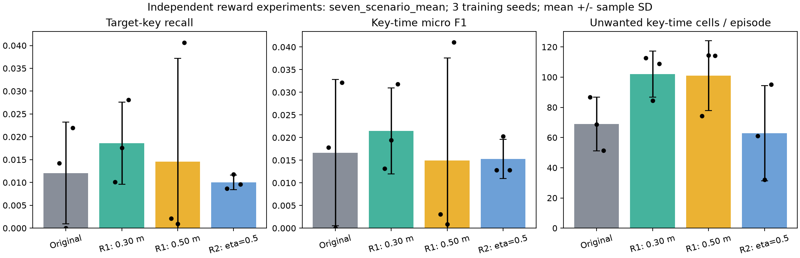
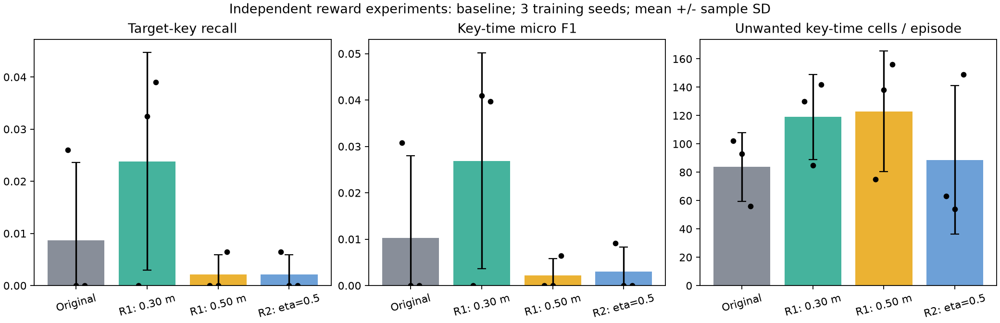
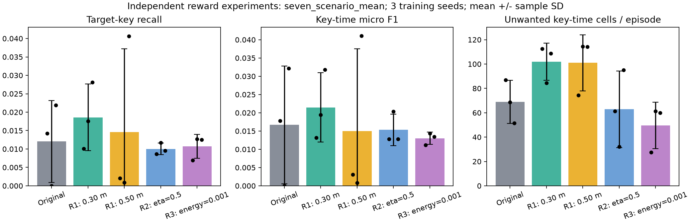
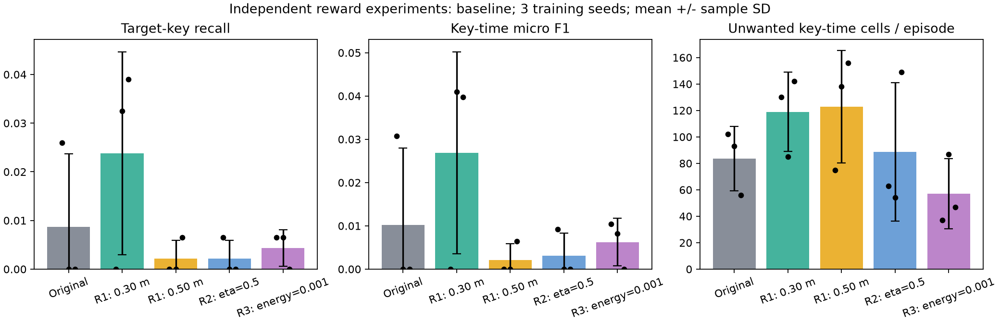

# RoboPianist PPO 与 SAC 完整实验开发日志

## 1. 文档信息

- 项目：RoboPianist
- 主仓库：/Users/jing/Local_Project/robopianist
- SAC 参考仓库：/Users/jing/Local_Project/robopianist-rl
- Python 环境：Robot_learning
- 实验整理日期：2026-10-20
- 训练任务：RoboPianist-debug-TwinkleTwinkleLittleStar-v0
- 本轮原则：不修改 PPO/SAC 的网络、损失函数和既有训练超参数；复用已保存的 20k 训练产物，补齐可复现评估、检查点选择、多场景泛化、失败分桶、图表和结果归档。

## 2. 实验目标

此前二维 reaching + pushing 项目形成了如下实验闭环：

1. 建立固定场景基线；
2. 保存训练日志和模型；
3. 在固定场景复现结果；
4. 扩展到多场景评估；
5. 保存并分析失败案例；
6. 按场景难度分桶；
7. 检查训练过程和早停点；
8. 通过消融实验定位泛化问题；
9. 记录可复现命令、结果和结论。

本实验把相同方法映射到 RoboPianist：

| 二维 pushing 流程 | RoboPianist 对应流程 |
|---|---|
| 固定物体与目标位置 | 原速度、原音高、固定手位的《小星星》 |
| 随机初始状态 | 随机双手初始位置 |
| 大/小 y 偏移分桶 | 曲速、移调、手位扰动分桶 |
| 到达目标成功率 | 音符 precision、recall、F1 |
| 最终物体距离 | episode return 与 return/step |
| 失败轨迹图 | 低 F1 场景清单与场景对比图 |
| 早停分析 | 逐检查点评估 |
| 定向采样消融 | 后续曲速/移调/手位课程学习候选实验 |

## 3. 可比性控制

### 3.1 两种算法共用的环境设置

    n_steps_lookahead = 10
    trim_silence = true
    gravity_compensation = true
    reduced_action_space = true
    control_timestep = 0.05
    primitive_fingertip_collisions = true
    change_color_on_activation = true

两种算法均使用确定性评估动作，并使用 RoboPianist 自带的 MidiEvaluationWrapper 计算音乐指标。

### 3.2 PPO 设置

来源：training_runs/ppo/RoboPianist-debug-TwinkleTwinkleLittleStar-v0-seed0/config.json

    训练 seed = 0
    请求交互数 = 20,000
    实际交互数 = 20,224（PPO rollout 长度导致向上取整）
    learning_rate = 3e-4
    n_steps = 256
    batch_size = 64
    n_epochs = 10
    gamma = 0.99
    gae_lambda = 0.95
    clip_range = 0.2
    policy network = [256, 256]
    观察归一化 = 开启
    奖励归一化 = 训练时开启

### 3.3 SAC 设置

来源：/Users/jing/Local_Project/robopianist-rl/training_runs/SAC-local-20k-seed42-v2/config.json

    训练 seed = 42
    交互数 = 20,000
    随机预热 = 1,000
    batch_size = 256
    replay_capacity = 50,000
    discount = 0.8
    actor_lr = 3e-4
    critic_lr = 3e-4
    temperature_lr = 3e-4
    critic 数量 = 2
    hidden_dims = [256, 256, 256]
    activation = GELU
    critic dropout = 0.01
    critic layer norm = 开启
    target update tau = 0.005

### 3.4 重要限制

本比较只有一个 PPO 训练种子和一个 SAC 训练种子，因此属于本机基线实验，不是可以进行统计显著性推断的多种子论文级比较。PPO 与 SAC 还使用了不同的折扣系数和网络结构；这些是现有运行配置的一部分，本轮没有改动。

## 4. 阶段一：接口验证

运行：

    python -m pytest learning/test_gymnasium_env.py -q

结果：

    3 passed in 0.22s

验证内容：

1. RoboPianist 观察字典能够稳定展平为 Gymnasium 向量；
2. 正常 MIDI 结束被标记为 truncated=True；
3. discount 为 0 的失败结束被标记为 terminated=True；
4. 动作被裁剪到合法连续范围。

## 5. 阶段二：固定场景基准复现

### 5.1 PPO

命令：

    python -m learning.evaluate_ppo --episodes 3

三回合结果完全一致：

    return = 142.497
    precision = 0.627329
    recall = 0.043478
    note F1 = 0.012422
    sustain F1 = 0.894410
    episode length = 161

### 5.2 SAC

命令：

    cd /Users/jing/Local_Project/robopianist-rl
    python evaluate_checkpoint.py \
      training_runs/SAC-local-20k-seed42-v2/checkpoint_latest.msgpack \
      --episodes 3

三回合结果完全一致：

    return = 452.259
    precision = 0.731884
    recall = 0.447205
    note F1 = 0.410973
    sustain F1 = 1.000000
    episode length = 161

### 5.3 基准结论

在约 20k 交互预算下：

- SAC return 约为 PPO 的 3.17 倍；
- SAC note F1 约为 PPO 的 33.1 倍；
- PPO precision 不低，但 recall 只有 0.0435，说明策略很少正确触发目标音符；
- SAC 同时取得较高 precision 和 recall，已经学到更有效的按键行为。

## 6. 阶段三：检查点扫描与早停诊断

### 6.1 PPO 检查点

每个 PPO 模型都与同一步数保存的 VecNormalize 状态配对，避免使用错误的观察统计量。

| 步数 | Return | Note F1 |
|---:|---:|---:|
| 1,024 | 326.521 | 0.043478 |
| 2,048 | 304.752 | 0.043478 |
| 3,072 | 300.555 | 0.043478 |
| 4,096 | 285.936 | 0.043478 |
| 5,120 | 227.796 | 0.043478 |
| 6,144 | 236.495 | 0.043478 |
| 7,168 | 222.529 | 0.043478 |
| 8,192 | 228.050 | 0.043478 |
| 9,216 | 221.272 | 0.043478 |
| 10,240 | 210.344 | 0.037267 |
| 11,264 | 205.806 | 0.043478 |
| 12,288 | 187.920 | 0.037267 |
| 13,312 | 163.927 | 0.031056 |
| 14,336 | 161.801 | 0.037267 |
| 15,360 | 149.218 | 0.037267 |
| 16,384 | 142.328 | 0.024845 |
| 17,408 | 119.949 | 0.006211 |
| 18,432 | 160.545 | 0.031056 |
| 19,456 | 133.114 | 0.031056 |
| 最终模型 | 142.497 | 0.012422 |

诊断：

- PPO 的评估回报总体随训练推进而下降；
- 1,024 步检查点具有最高回报，但 note F1 仍只有 0.0435；
- 最终模型的 note F1 低于绝大多数早期检查点；
- 这不是“训练不够久”，而是当前 PPO 配置在该任务上出现训练退化；
- 后续若继续 PPO，应使用早停、多个训练种子，并检查奖励归一化、rollout 长度和超参数，而不是盲目延长训练。

### 6.2 SAC 检查点

| 步数 | Return | Note F1 |
|---:|---:|---:|
| 5,000 | 334.523 | 0.043478 |
| 10,000 | 450.917 | 0.097308 |
| 15,000 | 388.596 | 0.114907 |
| 20,000 | 452.259 | 0.410973 |

诊断：

- SAC 的性能不是严格单调，15k return 低于 10k；
- note F1 从 5k 到 20k 总体上升；
- 20k 同时取得最高 return 和最高 note F1，因此当前最终检查点选择合理；
- replay buffer 对交互数据的重复利用，在这个小预算实验中明显优于当前 PPO 基线。

## 7. 阶段四：多场景泛化协议

场景定义保存在 learning/experiment_scenarios.json。

| 场景 | stretch | shift | 随机手位 | 目的 |
|---|---:|---:|---|---|
| baseline | 1.0 | 0 | 否 | 训练分布内基准 |
| tempo_slow_1.2 | 1.2 | 0 | 否 | 慢速泛化 |
| tempo_fast_0.8 | 0.8 | 0 | 否 | 快速泛化 |
| pitch_down_2 | 1.0 | -2 | 否 | 降调泛化 |
| pitch_up_2 | 1.0 | +2 | 否 | 升调泛化 |
| random_hand_positions | 1.0 | 0 | 是 | 初始手位泛化 |
| combined_hard | 0.8 | +2 | 是 | 组合困难场景 |

每个场景使用评估种子 20000、20001、20002，每种算法共运行 21 回合。

固定手位场景的三个种子结果完全相同。原因是这些场景没有启用随机手位，种子不会产生实际初态差异。随机手位场景出现了明显方差，说明评估协议成功覆盖了不同初始状态。

## 8. 阶段五：多场景结果

表中为三回合均值；括号中仅在存在实际随机差异时给出标准差。

| 算法 | 场景 | Return | Return/step | Precision | Recall | Note F1 | Sustain F1 |
|---|---|---:|---:|---:|---:|---:|---:|
| PPO | baseline | 142.497 | 0.885 | 0.627 | 0.043 | 0.012 | 0.894 |
| SAC | baseline | 452.259 | 2.809 | 0.732 | 0.447 | 0.411 | 1.000 |
| PPO | tempo_slow_1.2 | 192.019 | 0.995 | 0.617 | 0.041 | 0.021 | 0.927 |
| SAC | tempo_slow_1.2 | 554.032 | 2.871 | 0.780 | 0.404 | 0.372 | 1.000 |
| PPO | tempo_fast_0.8 | 105.016 | 0.814 | 0.605 | 0.054 | 0.031 | 0.938 |
| SAC | tempo_fast_0.8 | 375.372 | 2.910 | 0.846 | 0.519 | 0.460 | 1.000 |
| PPO | pitch_down_2 | 191.096 | 1.187 | 0.571 | 0.043 | 0.019 | 0.907 |
| SAC | pitch_down_2 | 417.640 | 2.594 | 0.966 | 0.161 | 0.153 | 1.000 |
| PPO | pitch_up_2 | 120.389 | 0.748 | 0.735 | 0.050 | 0.040 | 0.882 |
| SAC | pitch_up_2 | 432.117 | 2.684 | 0.902 | 0.236 | 0.216 | 1.000 |
| PPO | random_hand_positions | 159.566 ± 29.862 | 0.991 ± 0.185 | 0.714 ± 0.162 | 0.043 | 0.029 ± 0.012 | 0.903 ± 0.020 |
| SAC | random_hand_positions | 446.535 ± 28.466 | 2.774 ± 0.177 | 0.761 ± 0.107 | 0.321 ± 0.176 | 0.305 ± 0.174 | 1.000 |
| PPO | combined_hard | 101.569 ± 1.429 | 0.787 ± 0.011 | 0.782 ± 0.028 | 0.059 ± 0.007 | 0.046 ± 0.011 | 0.922 ± 0.033 |
| SAC | combined_hard | 337.540 ± 18.524 | 2.617 ± 0.144 | 0.908 ± 0.021 | 0.198 ± 0.068 | 0.181 ± 0.074 | 1.000 |

## 9. 阶段六：失败分桶与原因诊断

为每种算法分别把 note F1 最低的 25% 回合作为失败案例。结果位于：

    training_runs/full_experiment/failure_cases.csv

### 9.1 PPO 失败模式

PPO 的低 F1 阈值为 0.0186335。主要失败项：

- baseline 的三个回合；
- pitch_down_2 的三个回合；
- 随机手位 seed 20002。

PPO 的典型表现是 precision 尚可、recall 极低。这表示它倾向于少按键：按下时有一部分是正确的，但漏掉了绝大多数目标音符。由于回报还包含指法、前臂、能量和踏板等 shaping 项，较高 return 不一定对应较高 note F1。例如 pitch_down_2 的 return 高于 baseline，但 note F1 仍然很低。

### 9.2 SAC 失败模式

SAC 的低 F1 阈值为 0.157623。主要失败项：

- pitch_down_2 的三个回合；
- 随机手位 seed 20001；
- combined_hard 的 seed 20001 和 20002。

pitch_down_2 中 SAC precision 高达 0.966，但 recall 只有 0.161。这说明策略仍然较少误按，却无法覆盖移调后的多数目标音符。随机手位与组合场景的方差说明 SAC 对初始手位仍然敏感。

### 9.3 曲速结果

跨曲速比较累计 return 会受到回合长度影响：

- 慢速回合长度为 193；
- 基准回合长度为 161；
- 快速回合长度为 129。

因此必须同时查看 return/step。SAC 在快速场景中的 return/step 为 2.910，高于基准的 2.809；其 note F1 也从 0.411 上升至 0.460。当前策略对快速版本并未退化。慢速场景的 note F1 略降至 0.372。

## 10. 图表与原始数据

结果目录：

    training_runs/full_experiment/

主要文件：

    checkpoint_sweep.png
    scenario_f1.png
    scenario_episode_return.png
    scenario_return_per_step.png
    scenario_summary.csv
    scenario_summary.json
    failure_cases.csv
    ppo/scenario_results.csv
    ppo/scenario_results.json
    ppo/checkpoint_sweep.csv
    sac/scenario_results.csv
    sac/scenario_results.json
    sac/checkpoint_sweep.csv

说明：

- scenario_results.csv：逐回合原始结果；
- scenario_summary.csv：按算法和场景汇总的均值与标准差；
- failure_cases.csv：每种算法 note F1 最低 25% 的回合；
- checkpoint_sweep.png：相同评估口径下的训练进展；
- 三张 scenario 图片：场景级 return、return/step 和 note F1 对比。

## 11. 复现实验命令

### PPO 多场景评估

    cd /Users/jing/Local_Project/robopianist
    conda activate Robot_learning
    python -m learning.evaluate_ppo_scenarios

### PPO 检查点扫描

    python -m learning.evaluate_ppo_checkpoints

### SAC 多场景评估

    cd /Users/jing/Local_Project/robopianist-rl
    conda activate Robot_learning
    python evaluate_scenarios.py \
      training_runs/SAC-local-20k-seed42-v2/checkpoint_latest.msgpack

### SAC 检查点扫描

    python evaluate_checkpoint_sweep.py \
      training_runs/SAC-local-20k-seed42-v2

### 重新生成汇总和图表

    cd /Users/jing/Local_Project/robopianist
    python -m learning.build_full_experiment_report

## 12. 本轮结论

1. 现有 PPO 和 SAC 基准结果可以稳定复现；
2. SAC 在当前 20k 预算下显著优于 PPO；
3. PPO 在训练后期明显退化，当前最终模型不是理想检查点；
4. SAC 在 20k 检查点取得当前最佳结果；
5. SAC 对曲速变化较稳健，但对移调和随机手位仍然敏感；
6. PPO 的主要问题是极低 recall，而不是单纯 precision 不足；
7. return 与音乐准确率可能不一致，不能只用 return 判断钢琴策略；
8. 不同曲速必须同时报告 return/step；
9. 固定手位下重复不同种子不会产生真正不同场景；
10. 下一轮最有价值的实验是多训练种子、PPO 早停，以及加入移调和随机手位的课程学习；本轮遵守“不修改算法”的要求，没有启动这些训练变体。

## 13. 非阻塞警告

运行中出现两项依赖弃用警告：

- Python audioop 将在 Python 3.13 移除；
- TensorFlow Probability 使用的部分 JAX 映射接口已弃用。

本次所有命令均以退出码 0 完成，警告没有影响当前实验结果。

## 14. 后续实验一：原 PPO 单训练种子与多训练种子对照（2026 年 10 月 23 日）

- 对照整理日期：2026 年 10 月 23 日
- 训练任务：`RoboPianist-debug-TwinkleTwinkleLittleStar-v0`
- 目的：检验此前只报告一次 PPO 训练（seed 0）会遗漏多少训练随机性。这里的“多训练种子”不是新算法或模型集成，而是把**同一 PPO 配置独立训练三次**。

### 14.1 对照口径

单种子组复用此前保存的原 PPO 最终模型（训练 seed 0）；多种子组复用此前分别以训练 seed 20000、20001、20002 保存的三个原 PPO 最终模型。本轮没有重新训练这些模型。四次训练均请求 20000 步，实际最终模型为 20224 步；网络、损失、学习率、归一化与其余配置保持相同，训练种子是主要差异。

为避免把测试条件差异误当作训练种子效应，本轮将 seed 0 模型重新放到与其他三个模型**完全相同**的 7 个场景和评估种子 40000、40001、40002 上测试。每个模型对应 21 个评估回合。均使用最终模型、与模型配套的 `vecnormalize.pkl` 和确定性动作。固定手位场景的三个评估种子结果相同，不能算作三个独立训练结果。

### 14.2 固定手位《小星星》结果

| 原 PPO 训练种子 | 回合总奖励 | 音符召回率 | 音符 F1 |
|---:|---:|---:|---:|
| 0：此前单种子结果 | 142.497 | 0.043478 | 0.012422 |
| 20000 | 146.797 | 0.043478 | 0.037267 |
| 20001 | 200.070 | 0.111801 | 0.081781 |
| 20002 | 145.601 | 0.049689 | 0.037267 |
| **20000–20002 三种子均值 ± 样本标准差** | **164.156 ± 31.108** | **0.068323 ± 0.037781** | **0.052105 ± 0.025700** |

这里的“±”只依据三个**独立训练模型**计算；seed 0 是一个单独样本，不应为它计算训练种子标准差。

### 14.3 七场景等权平均

先在每个训练模型内部，对 7 个场景及各场景的评估种子等权平均；再对训练 seed 20000、20001、20002 的三个模型求均值与样本标准差。

| 指标 | 原 PPO：单训练 seed 0 | 原 PPO：三个训练种子均值 ± 样本标准差 |
|---|---:|---:|
| 回合总奖励 | 140.146 | 160.061 ± 41.409 |
| 音符召回率 | 0.047453 | 0.062018 ± 0.011265 |
| 音符 F1 | 0.024957 | 0.042354 ± 0.008473 |

三种子组各模型的七场景音符 F1 分别为 0.045838、0.048529、0.032695；单种子 seed 0 为 0.024957。单次训练的结果可能偏离另外几个种子的平均水平，但这些差异不能解释为“多种子训练让同一个模型变好”——各行对应的是不同的独立模型，且本实验只有四个训练种子。

### 14.4 结论与产物

多训练种子的主要收益是看见训练结果的波动，而不是直接提高某个 PPO 策略的能力。原先 seed 0 的固定场景音符 F1 为 0.012422；另外三个原 PPO 模型的均值为 0.052105，且三者本身差异明显。以后报告 PPO 表现，应逐训练种子展示结果并给出训练种子间的均值与标准差；不能把一个有利的训练种子当作算法的稳定性能，也不能把同一模型的三个评估回合当作三个训练种子。

- seed 0 重新评估的原始数据：`training_runs/seed_comparison_20000_20002/ppo/seed0/scenario_results.csv`
- 另外三个原 PPO 模型的原始数据：`training_runs/seed_comparison_20000_20002/ppo/seed{20000,20001,20002}/scenario_results.csv`
- 单种子复测命令：

```bash
python -m learning.evaluate_ppo_scenarios --training-seed 0 \
  --seeds 40000 40001 40002 \
  --output-dir training_runs/seed_comparison_20000_20002/ppo/seed0
```

## 15. 后续实验二：三训练种子 PPO 更新幅度配对对照（2026 年 10 月 23 日）

- 实验日期：2026 年 10 月 23 日
- 任务：`RoboPianist-debug-TwinkleTwinkleLittleStar-v0`
- 目标：检查限制 PPO 策略更新幅度，能否改善最终模型的音符演奏表现。本节是独立于 2026-10-20 原实验的后续记录，不改写原实验结论。

### 15.1 实验设计

本实验只比较两种 PPO 配置，不将 SAC 的单个训练种子当作多种子对照。

| 组别 | 与原 PPO 的差异 | 训练种子 |
|---|---|---|
| 原 PPO | 无；复用此前完整训练并保存的原样基线模型 | 20000、20001、20002 |
| 限制更新幅度的 PPO | 增加 `target_kl=0.1`，其余训练参数不变 | 20000、20001、20002 |

原 PPO 的三次训练是此前刚完成的原样运行，本轮没有重新执行相同的确定性训练。两组均请求 20000 个环境交互步；由于 256 步的 rollout 批次，最终模型均实际训练到 **20224 步**。两组共同使用：学习率 `3e-4`、`n_steps=256`、`batch_size=64`、`n_epochs=10`、`gamma=0.99`、`gae_lambda=0.95`、`clip_range=0.2`、网络 `[256, 256]`、观察与训练奖励归一化。配置文件核对显示，除输出目录与 `target_kl` 外，两组参数相同。

`target_kl` 是 Stable-Baselines3 PPO 的提前停止条件，不是把动作裁剪到某个范围。原 PPO 未传入该参数，保持原代码行为。短跑验证显示，限制组达到 KL 上限时确实提前结束本轮优化。

### 15.2 评估方法

每个训练种子的**最终模型**，均在 `learning/experiment_scenarios.json` 中的 7 个场景评估，每场景使用 40000、40001、40002 三个评估种子，动作采用确定性预测。两组各有 3 个独立训练模型、63 个场景评估回合。评估种子没有用于本轮的策略训练。每个 PPO 模型使用与其配套的 `vecnormalize.pkl`，评估时关闭归一化统计更新与奖励归一化。

主要指标是 RoboPianist `MidiEvaluationWrapper` 报告的逐控制步音符 F1；同时记录音符召回率、回合总奖励和训练中的近似 KL / 裁剪比例。以下“±”为**三个训练种子所得均值的样本标准差**，不是 63 个评估回合的独立样本标准差。固定手位场景下，同一模型的三个评估种子给出相同结果。

### 15.3 固定手位《小星星》结果

| 训练种子 | 原 PPO：总奖励 | 限制组：总奖励 | 原 PPO：音符 F1 | 限制组：音符 F1 | 原 PPO：召回率 | 限制组：召回率 |
|---:|---:|---:|---:|---:|---:|---:|
| 20000 | 146.797 | 190.567 | 0.037267 | 0.037267 | 0.043478 | 0.043478 |
| 20001 | 200.070 | 185.355 | 0.081781 | 0.037267 | 0.111801 | 0.043478 |
| 20002 | 145.601 | 200.506 | 0.037267 | 0.031056 | 0.049689 | 0.043478 |
| **均值 ± 标准差** | **164.156 ± 31.108** | **192.143 ± 7.697** | **0.052105 ± 0.025700** | **0.035197 ± 0.003586** | **0.068323 ± 0.037781** | **0.043478 ± 0.000000** |

### 15.4 七场景等权平均

先对每个模型的 7 个场景及各场景评估种子取等权平均，再在 3 个独立训练种子之间求均值和样本标准差。

| 指标 | 原 PPO | 限制更新幅度的 PPO |
|---|---:|---:|
| 回合总奖励 | 160.061 ± 41.409 | 201.528 ± 5.082 |
| 音符召回率 | 0.062018 ± 0.011265 | 0.045826 ± 0.000512 |
| 音符 F1 | 0.042354 ± 0.008473 | 0.038901 ± 0.002340 |

各场景音符 F1 的三训练种子平均值：

| 场景 | 原 PPO | 限制组 |
|---|---:|---:|
| 固定基准 | 0.052105 | 0.035197 |
| 慢速 1.2 | 0.025331 | 0.027634 |
| 快速 0.8 | 0.056848 | 0.049096 |
| 降 2 个半音 | 0.038302 | 0.037267 |
| 升 2 个半音 | 0.035966 | 0.037267 |
| 随机初始手位 | 0.033701 | 0.035887 |
| 组合困难场景 | 0.054227 | 0.049957 |

不同曲速的回合长度不同，因此跨场景直接平均的总奖励只是辅助指标；不能据此认定哪组弹奏更好。

### 15.5 更新幅度是否真正降低

读取两组 TensorBoard 训练记录，按各次记录的平均值汇总：

| 训练种子 | 原 PPO：平均近似 KL | 限制组：平均近似 KL | 原 PPO：平均裁剪比例 | 限制组：平均裁剪比例 | 原 PPO：优化轮次 | 限制组：优化轮次 |
|---:|---:|---:|---:|---:|---:|---:|
| 20000 | 0.969 | 0.148 | 0.759 | 0.396 | 790 | 333 |
| 20001 | 0.992 | 0.148 | 0.760 | 0.403 | 790 | 335 |
| 20002 | 1.037 | 0.145 | 0.761 | 0.397 | 790 | 328 |

限制组的每次训练都出现了 KL 提前停止，说明更新幅度确实明显降低。`target_kl=0.1` 并不意味着日志里的平均近似 KL 必须小于 0.1：Stable-Baselines3 的实际停止判断是当前小批次的近似 KL 超过 `1.5 × target_kl`，而日志汇总口径也不同。

### 15.6 结论与边界

本实验支持一个有限但明确的结论：**单独给现有 PPO 增加 `target_kl=0.1`，确实降低了策略更新幅度，却没有提高音符 F1。** 固定场景和七场景等权平均的音符 F1 均略低；与此同时，总奖励提高。这提示总奖励和弹奏准确性在当前任务中并不完全一致，不能只用奖励判断策略是否更会弹琴。

限制组的结果在三个种子之间波动较小，但样本只有 3 个独立训练种子，不能据此宣称已证明其统计意义上的稳定性更好，也不能断定 `target_kl=0.1` 是最佳阈值或“更新过大”是原 PPO 表现不佳的唯一原因。下一步若继续研究，应分别测试较宽松的 KL 阈值和奖励各组成项，并坚持用同样的训练种子、最终模型及音乐指标评估。

### 15.7 产物位置与复现

- 原 PPO 模型及训练记录：`training_runs/ppo/RoboPianist-debug-TwinkleTwinkleLittleStar-v0-seed{20000,20001,20002}/`
- 限制组模型及训练记录：`training_runs/ppo_target_kl_0p1/RoboPianist-debug-TwinkleTwinkleLittleStar-v0-seed{20000,20001,20002}/`
- 各模型目录内的 `training_console.log` 保留了训练输出；`tensorboard/` 保留逐轮指标。
- 原 PPO 原始评估：`training_runs/seed_comparison_20000_20002/ppo/seed*/scenario_results.csv`
- 限制组原始评估：`training_runs/seed_comparison_20000_20002/ppo_target_kl_0p1/seed*/scenario_results.csv`

从 RoboPianist 仓库根目录运行的单种子示例：

```bash
python -m learning.train_ppo --seed 20000 --total-timesteps 20000 \
  --target-kl 0.1 --output-dir training_runs/ppo_target_kl_0p1

python -m learning.evaluate_ppo_scenarios --training-seed 20000 \
  --run-dir training_runs/ppo_target_kl_0p1/RoboPianist-debug-TwinkleTwinkleLittleStar-v0-seed20000 \
  --seeds 40000 40001 40002 \
  --output-dir training_runs/seed_comparison_20000_20002/ppo_target_kl_0p1/seed20000
```

原 PPO 复现命令与上面训练命令相同，但**不传 `--target-kl`**，并使用独立输出目录，以免覆盖任何已保存模型。

## 16. 后续实验三：失败分桶、按键时间图与定向曲速采样（2026 年 10 月 23 日）

- 实验日期：2026 年 10 月 23 日
- 研究问题：原 PPO 在什么条件、乐曲的哪一段、以什么方式弹错？针对最薄弱场景调整训练采样，能否改善真正的目标按键命中？
- 比较对象：原 PPO 和“慢速定向采样”PPO，训练种子均为 20000、20001、20002。本节不改变 SAC，也不把二维 reaching/pushing 的动作维度、奖励系数或成功即停止规则复制到钢琴任务。

### 16.1 失败记录与指标口径

新增 `learning/diagnose_ppo_failures.py`。它用同一最终模型和 `vecnormalize.pkl`，对每个场景、评估种子逐控制步记录：目标按键、实际激活按键、正确激活、漏按、误按、时间（秒）及所属乐曲四分之一段。对随机手位还从手部根节点的初始位置记录**实际有符号 y 方向偏移量**，再按绝对偏移分桶；这里的随机手位是双手共享的 ±5 cm 范围位移。每个场景的首个代表性回合生成目标/实际/错误三层按键激活时间图。图中红色为漏按，蓝色为误按，绿色竖线为时间四分段边界。

除 RoboPianist `MidiEvaluationWrapper` 的逐步音符 F1，还统计“按键-时间格”的 micro F1：`2TP/(2TP+FN+FP)`，以及目标按键召回 `TP/(TP+FN)`。一个长音被持续按对多个控制步，会贡献多个格；它们不是不同的音符起音。这个补充口径很重要：官方包装器使用 `zero_division=1`，无目标音符的时间步也进入平均，因而**官方 F1 大于零不保证真正按中过目标键**。例如原 PPO 的训练 seed 20000 在固定原速场景的官方 F1 为 0.037267，但目标按键命中格数为 0。

原 PPO 三个模型在既有 7 场景 × 3 评估种子上共检查 63 个完整回合，所有回合都走到了对应 MIDI 的末尾。为了观察“幅度”，另测曲速 0.9、1.1 和移调 ±1、±4 半音（加上既有的 0.8、1.2、±2）；并在随机手位场景额外使用 40000–40011 共 12 个评估种子。扩展场景只用于诊断，不并入下面的 7 场景训练对照均值。

### 16.2 原 PPO 的主要失败

| 场景（三训练种子平均） | 官方逐步 F1 | 按键-时间格 micro F1 | 目标按键召回 | 每回合平均正确/漏按/误按格数 |
|---|---:|---:|---:|---:|
| 固定原速 | 0.052105 | 0.034528 | 0.025974 | 4.0 / 150.0 / 78.3 |
| 慢速 1.2 | 0.025331 | 0.002574 | 0.001792 | 0.3 / 185.7 / 75.3 |
| 随机初始手位 | 0.033701 | 0.003848 | 0.002886 | 0.4 / 153.6 / 61.3 |
| 快速 0.8 | 0.056848 | 0.030263 | 0.024000 | 3.0 / 122.0 / 57.3 |

最薄弱的既有场景是慢速 1.2：平均每回合约 186 个目标按键-时间格中，只命中 0.3 格。固定原速也不理想，因此后续训练采样是**待检验的干预**，不能预先假设会改善弹奏。

按乐曲四分段统计，原 PPO 固定原速场景的目标按键召回分别为 0.0940、0、0、0.0088；慢速 1.2 场景为 0、0、0.0072、0。固定原速的误按更多出现在末段，但主要问题是全曲大量漏按，并非只在结束时失败。按键图直观展示了目标键长时间未被激活：





补充曲速/移调幅度诊断中，慢速 1.1 的按键-时间格 micro F1 为 0.00525，慢速 1.2 为 0.00257；快速 0.9 为 0.03526、快速 0.8 为 0.03026。移调 ±1、±2、±4 的命中总体仍极低，但未形成足以声称“幅度越大越差”的单调关系。原始逐回合数据保存在 `extra_diagnosis/episode_failures.csv`。

随机手位额外 12 个评估种子的偏移分桶如下；同一个评估种子会在三个训练模型上重复，所以“回合数”不等于独立手位抽样数：

| 绝对初始手位偏移 | 独立评估种子数 | 回合数 | 目标按键召回 |
|---|---:|---:|---:|
| 0–1 cm | 4 | 12 | 0.02381 |
| 1–2.5 cm | 1 | 3 | 0.03030 |
| 2.5–4 cm | 3 | 9 | 0.01227 |
| 4–5 cm | 4 | 12 | 0.00487 |

较大偏移对应较低召回是本次样本中的描述性现象；中间桶样本很少，不能据此推出可靠的单调规律或显著性结论。

### 16.3 基于诊断的训练采样干预

选择既有七场景中最弱的“慢速 1.2”作为**唯一**定向采样对象，不同时改变 PPO 更新幅度、奖励或模型结构。三个训练种子分别从头训练，各请求 20000 步，最终均为 20224 步，`target_kl=None`、优化轮次 790，与原 PPO 的更新设置一致：

1. 前 32 个完整回合：只抽取原速《小星星》；
2. 之后每个新回合：70% 概率抽取时长拉伸 1.2 倍的完整乐曲，30% 保留原速；
3. 不在任何音符或目标按对时提前结束。短跑实测原速回合 161 步、慢速回合 193 步，均走到各自 MIDI 结尾，`discount=1`。

采样实现于 `learning/tempo_curriculum.py`，由 `learning/train_ppo.py` 的 `--slow-tempo-curriculum` 开关启用；默认不启用，保留原 PPO 行为。每份运行保存 `curriculum_episodes.csv`，核实实际抽样如下：

| 训练种子 | 原速热身回合 | 后续慢速回合 | 后续原速回合 |
|---:|---:|---:|---:|
| 20000 | 32 | 56 | 27 |
| 20001 | 32 | 63 | 19 |
| 20002 | 32 | 55 | 28 |

### 16.4 配对评估结果

原 PPO 和课程 PPO 均取**最终模型**，在相同的既有 7 场景和评估种子 40000、40001、40002 上测试；每组 3 个独立训练模型、63 个完整评估回合。以下“±”是先对每个训练模型求场景均值，再在三个训练种子之间计算的样本标准差，不能把同一模型的多个评估回合误当作独立训练。

| 指标 | 原 PPO 三种子 | 慢速定向采样 PPO 三种子 |
|---|---:|---:|
| 固定原速：官方逐步音符 F1 | 0.052105 ± 0.025700 | 0.031056 ± 0.000000 |
| 固定原速：按键-时间格 micro F1 | 0.034528 ± 0.053779 | 0.000000 ± 0.000000 |
| 慢速 1.2：官方逐步音符 F1 | 0.025331 ± 0.005276 | 0.025907 ± 0.005181 |
| 慢速 1.2：按键-时间格 micro F1 | 0.002574 ± 0.004458 | 0.000000 ± 0.000000 |
| 七场景等权平均：官方逐步音符 F1 | 0.042354 ± 0.008473 | 0.034704 ± 0.001426 |
| 七场景等权平均：按键-时间格 micro F1 | 0.017564 ± 0.010905 | 0.001860 ± 0.001771 |
| 七场景等权平均：回合总奖励 | 160.061 ± 41.409 | 150.159 ± 8.002 |

课程组三个最终模型在固定原速与慢速 1.2 的测试中，**目标按键-时间格命中均为 0**。慢速场景官方逐步 F1 的轻微均值上升，并不代表真正的按键改善。逐种子对照中，慢速场景官方 F1 为：原 PPO `0.031088/0.024180/0.020725`，课程 PPO `0.025907/0.020725/0.031088`；只有第三个种子上升。课程组的慢速按键图同样展示了大量漏按与非目标键激活：



逐按键诊断重新运行后的官方 F1 和回合奖励，与原有 `evaluate_ppo_scenarios.py` 对应的全部 126 行结果逐一核对，无不一致。

### 16.5 结论、边界与产物

本实验支持的结论是：失败分桶和按键时间图揭示了**整段漏按与目标键几乎不命中**，而非简单的某一段乐曲速度问题。针对慢速场景提高抽样比例的这一个课程方案，在当前 20k 交互预算和三训练种子下**没有改善实际目标按键命中，反而降低了七场景 micro F1**。这不等于所有课程学习都无效；也不能仅凭三个训练种子作统计显著性判断。下一步若继续改进，优先检查奖励各组成项与按键命中目标的对齐程度，再设计更有依据的采样或训练策略。

原始数据和模型均在 `training_runs/failure_curriculum_2026-10-23/` 及 `training_runs/ppo_slow_tempo_curriculum/`：

GitHub 仓库仅保存本轮的评估表、逐步诊断数据、按键时间图和采样记录；训练得到的模型权重、归一化统计及 TensorBoard 日志仍只保存在本机，不作为 Git 跟踪文件。复现评估时需要先按上述配置训练并保存对应模型。

- `diagnosis/`：原 PPO 的 63 回合逐步按键、按乐曲四分段汇总及七张时间图；
- `extra_diagnosis/`：曲速 0.9/1.1 与移调 ±1/±4 的补充场景；
- `hand_offset_sweep/`：12 个手位评估种子的实际偏移与失败分桶；
- `curriculum_eval/`、`curriculum_diagnosis/`：课程 PPO 在相同 7 场景的官方与逐按键评估；
- `ppo_slow_tempo_curriculum/`：三个模型、归一化统计、TensorBoard、控制台日志及逐回合采样记录。

从仓库根目录复现单种子的核心命令：

```bash
python -m learning.diagnose_ppo_failures \
  --output-dir training_runs/failure_curriculum_2026-10-23/diagnosis

python -m learning.train_ppo --seed 20000 --total-timesteps 20000 \
  --slow-tempo-curriculum --curriculum-warmup-episodes 32 \
  --curriculum-slow-probability 0.7 --curriculum-slow-stretch 1.2 \
  --output-dir training_runs/ppo_slow_tempo_curriculum

python -m learning.diagnose_ppo_failures \
  --runs-dir training_runs/ppo_slow_tempo_curriculum \
  --output-dir training_runs/failure_curriculum_2026-10-23/curriculum_diagnosis
```

## 17. 补充诊断：为什么会大量漏按（2026 年 10 月 23 日）

本节是对已保存原 PPO 模型的**只读复核**，没有修改奖励、模型或训练数据。复用三个训练种子 20000、20001、20002 的最终模型及各自的 `vecnormalize.pkl`，在固定原速《小星星》、评估种子 40000、确定性动作下，各运行一个完整的 161 步回合。逐步读取 `task.reward_fn.reward_terms`，并把目标琴键的物理位置除以琴键行程上限，以检查目标键是否真正被压下。下表中的奖励项是**整个回合的累计值**，而非每步均值；各项相加等于回合总奖励。

| 训练种子 | 目标键命中/漏按/误按格 | 按键奖励 | 踏板奖励 | 指尖接近目标键奖励 | 前臂奖励 | 能量奖励 | 总奖励 |
|---:|---:|---:|---:|---:|---:|---:|---:|
| 20000 | 0 / 154 / 45 | 68.019 | 148.001 | 0.028 | 15.000 | -84.252 | 146.797 |
| 20001 | 11 / 143 / 63 | 65.878 | 152.001 | 3.101 | 55.000 | -75.910 | 200.070 |
| 20002 | 1 / 153 / 127 | 51.025 | 139.002 | 1.375 | 43.000 | -88.801 | 145.601 |

最明显的是 seed 20000：161 步中有 136 步没有误按，按键奖励函数的“无误按”部分单独提供了 `136 × 0.5 = 68`；目标键下压部分仅贡献约 0.019。在 154 个要求目标键的时间格中，测得的归一化目标键下压状态各分位数均为 0。因此这个模型的漏按不主要是“琴键压得接近阈值、只差一点触发”，而是多数目标键根本没有被压下。其总奖励仍为 146.797，说明**总奖励不能替代真实触键指标**。另两个种子的命中也很少，但本节只检查每个模型的一个固定评估回合，不能据此确定唯一因果机制。

可能原因按当前证据分层：

1. **奖励与目标按键命中未充分对齐，是直接观察到的风险。**`piano_with_shadow_hands.py` 的总奖励相加了按键、踏板、指尖位置、前臂和能量项；按键项还包含“无误按”奖励。当前 PPO 可以在没有正确触键时获得可观回报。这并不证明官方奖励函数本身错误。
2. **有效探索不足是待检验假设。**指尖奖励很低、目标键几乎未被压下，提示双手定位与触键动作链尚未学会。需要进一步记录训练时的指尖距离、触键率及动作裁剪率；只延长 20k 训练预算可能继续强化现有行为。
3. **原 PPO 更新幅度大，但不是单独原因。**第 15 节中的 `target_kl=0.1` 对照使近似 KL 和裁剪比例下降，却未提高音符 F1。
4. **动作尺度、曲首准备时间和确定性评估仍是未验证因素。**先检查动作边界裁剪及随机/确定性动作的真实触键差异，再考虑逐项消融；不能把尚未测量的因素写成已查明根因。

建议后续实验保持相同训练种子、训练步数与完整乐曲终止规则，每次只改变一个因素，并以目标键召回与按键-时间格 micro F1 为主要判断指标。

## 18. 奖励实验第一轮：扩大指尖接近奖励范围（2026 年 10 月 26 日）

- 改动记录日期：2026 年 10 月 26 日。
- 实验启动日期：2026 年 10 月 26 日（Europe/Berlin）。
- 研究问题：只扩大指定指尖接近当前目标琴键时的奖励有效范围，能否改善 PPO 的接近、触键与演奏表现？
- 前置证据：复核三个原 PPO 最终模型各一个固定原速回合，指定指尖到当前目标琴键的距离中位数分别为 0.5983、0.5768、0.4498 米。此为训练结束后的确定性回放，不能替代训练过程的距离分布，也不能据此确定唯一根因。
- 方案来源：RoboPianist（2023）第 4.1、4.2 节和附录 B 关于指法先验、稠密接近奖励与误按惩罚的设计；候选 margin 数值是本项目的待验证超参数，不是论文给定的最优值。论文：https://arxiv.org/abs/2304.04150 。

### 18.1 配对设计与代码

三组 Gaussian tolerance 的满分距离均保持 0.01 米，只改变 `fingering_reward_margin`：原始组 0.10 米、实验 A 组 0.30 米、实验 B 组 0.50 米。每组从头训练 seed 20000、20001、20002，共九个模型；不覆盖以前的模型。每次请求 20000 步，按原有 256 步 rollout 实际到 20224 步。所有组使用单个 PyTorch 计算线程，网络、PPO 参数、奖励归一化和其余奖励项保持一致；不启用慢速课程或 KL 提前停止。

- `robopianist/suite/tasks/piano_with_shadow_hands.py`：增加可配置的指尖 Gaussian margin，默认 0.10 米。
- `learning/common.py`、`learning/train_ppo.py`：通过环境参数、命令行和保存的 config 传递 margin。
- `learning/reward_diagnostics.py`：在每个训练步自动 reset 之前记录当前 MIDI 目标对应的指尖距离、接近比例、目标键下压、TP/FN/FP、原始奖励分项与动作裁剪比例；每个 rollout 保存汇总。
- `learning/run_fingering_margin_experiment.py`：训练、统一评估、逐种子汇总和作图。
- `learning/test_fingering_margin.py`：检查默认行为回归、物理状态与其他奖励不变、记录的统一原始奖励正确，以及参数合法性。

### 18.2 评估与判据

所有最终模型在既有七场景、评估 seed 40000、40001、40002 上确定性评估，每组 63 个完整回合，总计 189 个回合。评估环境统一使用 margin=0.10 米，不更新观察归一化统计、不归一化评估奖励，加载各模型自己的 `vecnormalize.pkl`。由于 margin 只影响奖励，统一评估不改变动力学或观测。

主要判据是目标按键-时间格召回、micro F1 和误按量；同时查看指定指尖距离、进入 1/5 厘米范围的比例及目标键下压量。官方逐控制步 F1 另行保留，不能与 micro F1 混用。对每个训练模型先在评估种子和场景内求均值，再在三个独立训练种子间求均值和样本标准差；固定手位下重复的评估种子不作为独立训练样本。跨训练组不比较各自修改后奖励的绝对高低；表中回报统一按原始奖励计算。

实验目录：`training_runs/reward_margin_2026-10-26/`。训练与评估状态、参数、逐步数据和图表均已保存，结果如下。

复现命令（仓库根目录、Robot_learning 环境）：

```bash
python -B -m learning.run_fingering_margin_experiment \
  --output-dir training_runs/reward_margin_2026-10-26 --workers 3
```

### 18.3 完成时间与验证（改动记录日期：2026 年 10 月 26 日）

原始运行时间戳（保留用于复现）：实验启动于 2026-10-26 23:57，因跨午夜，全部训练与评估完成于 **2026-10-27 00:06:01（Europe/Berlin，UTC+1）**。九个最终模型均为 20224 步，九份 config 在排除训练种子、输出目录和 margin 后完全相同。三组各完成 63 个回合、9855 个对齐的控制步，共 **189 个完整回合、29565 个评估控制步**，全部走到 MIDI 末尾。

接口、失败统计、课程回归及本轮奖励回归共 **26 项测试通过**。另逐回合重新计算 TP/FN/FP 对应的 recall 和 micro F1，均与输出一致；评估逐步原始奖励之和与回合回报一致。检查训练末步诊断与向量环境自动 reset 的顺序，诊断在 auto-reset 之前采集。启动时的 macOS 后台线程导入阻塞已通过避免在线程中导入物理库修正，该次启动没有进入训练。

注意：本轮 **0.10 米组也重新训练了三次**，使用统一的单线程计算和诊断记录，属于新的原始奖励对照，不能当作第 14–17 节历史检查点的重复评估。以下比较均在本轮九个模型之间进行，不把本轮与历史原始组的数值差异归因于 margin。

### 18.4 固定原速《小星星》结果

下表为三个独立训练模型的均值 ± 样本标准差。召回率采用真实目标按键-时间格口径，排除静音步带来的官方指标差异。

| 训练 margin | 目标键召回率 | micro F1 | 官方逐步 F1 | 每回合平均 TP / FN / FP | 指定指尖平均距离 |
|---|---:|---:|---:|---:|---:|
| 0.10 米：本轮原始组 | 0.866% ± 1.500% | 0.010256 ± 0.017765 | 0.031746 ± 0.006325 | 1.33 / 152.67 / 83.67 | 43.62 ± 10.63 cm |
| 0.30 米 | 2.381% ± 2.087% | 0.026906 ± 0.023310 | 0.041201 ± 0.014274 | 3.67 / 150.33 / 119.00 | 35.78 ± 7.34 cm |
| 0.50 米 | 0.216% ± 0.375% | 0.002144 ± 0.003713 | 0.023366 ± 0.002561 | 0.33 / 153.67 / 123.00 | 25.38 ± 0.94 cm |

目标键的平均归一化下压量分别为 0.010554、0.036395、0.014253。0.30 米组的命中和下压均值有所增加，但仍漏掉约 97.6% 的目标按键-时间格；0.50 米组虽然指尖更接近目标，却没有提高固定原速触键表现。

### 18.5 七场景等权结果与逐种子核对

先对每个模型的每场景三个评估种子取均值，再对七场景等权平均，最后在三个训练模型之间计算均值和样本标准差。不同场景的回合长度不同，因此每回合的误按格数与回报均为描述性辅助指标，主要比较同协议下的召回与 micro F1。

| 指标 | margin 0.10 米 | margin 0.30 米 | margin 0.50 米 |
|---|---:|---:|---:|
| 目标键召回率 | 1.206% ± 1.113% | 1.860% ± 0.903% | 1.455% ± 2.261% |
| 按键-时间格 micro F1 | 0.016669 ± 0.016125 | 0.021470 ± 0.009506 | 0.014977 ± 0.022583 |
| 官方逐步音符 F1 | 0.039725 ± 0.010142 | 0.045127 ± 0.006787 | 0.037103 ± 0.012096 |
| 每回合平均误按格数 | 68.97 ± 17.69 | 101.94 ± 15.24 | 100.98 ± 23.12 |
| 指定指尖平均距离 | 42.37 ± 8.10 cm | 36.90 ± 7.88 cm | 25.56 ± 1.08 cm |
| 指尖距离 ≤ 5 cm 比例 | 1.260% ± 1.719% | 4.143% ± 1.811% | 3.091% ± 3.599% |
| 目标键平均归一化下压量 | 0.016479 ± 0.014101 | 0.027886 ± 0.010804 | 0.024164 ± 0.032741 |
| 按统一原始奖励计算的回报 | 171.531 ± 26.006 | 179.924 ± 35.371 | 170.509 ± 11.757 |

七场景 micro F1 的逐训练种子结果：

| 训练种子 | margin 0.10 米 | margin 0.30 米 | margin 0.50 米 |
|---:|---:|---:|---:|
| 20000 | 0.017819 | 0.013158 | 0.003087 |
| 20001 | 0.000000 | 0.019418 | 0.000823 |
| 20002 | 0.032188 | 0.031834 | 0.041020 |

0.30 米组的七场景 micro F1 只在 seed 20001 上提高；seed 20000 下降，seed 20002 略降。因此不能把均值的小幅上升表述为三个种子一致改善或统计显著提升。

分场景 micro F1：

| 场景 | margin 0.10 米 | margin 0.30 米 | margin 0.50 米 |
|---|---:|---:|---:|
| 固定原速 | 0.010256 | 0.026906 | 0.002144 |
| 慢速 1.2 | 0.030379 | 0.015657 | 0.002222 |
| 快速 0.8 | 0.010471 | 0.042813 | 0.012520 |
| 降 2 半音 | 0.011348 | 0.003683 | 0.001921 |
| 升 2 半音 | 0.040404 | 0.020263 | 0.030586 |
| 随机初始手位 | 0.004826 | 0.013455 | 0.050374 |
| 组合困难 | 0.008998 | 0.027510 | 0.005071 |

0.30 米组在固定原速、快速、随机手位、组合困难场景均值上升，两个移调与慢速场景下降。0.50 米组的随机手位高均值主要来自训练 seed 20002 在评估 seed 40000、40002 的两个回合，其他两个训练种子在随机手位中均无目标键命中；不能据此宣称它具有稳定的手位鲁棒性。

### 18.6 结论与下一步边界

1. 扩大 margin 确实影响了指定指尖接近目标键的行为，0.50 米组的平均距离明显更短。这支持研究接近奖励的有效范围，但不证明已找到 PPO 失败的唯一根因。
2. **接近不等于按对。**0.50 米组更接近目标键，却在固定原速及七场景平均 micro F1 上差于本轮原始组。0.30 米组的平均真实召回和 micro F1 有限提高，同时误按增加，且逐训练种子的改善不一致。
3. 当前三个设置都仍有大量漏按，20k 交互预算及三个训练种子不足以证明稳定提升；也没有依据把 margin 越大解释为越好。训练曲线中的随机动作触键率和最终确定性评估结果分别记录，不能互相替代。
4. 暂保留原始默认 margin=0.10 米。0.30 米可作为下一轮下压奖励实验的候选，但需要继续设置单因素对照，不能同时改变能量惩罚、熵系数、网络和训练预算。第二轮尚未启动。

### 18.7 结果文件与图片

- `manifest.json`、`training_status.json`、`complete.json`：实验设计、训练状态与完成时间。
- `models/margin_0p{1,3,5}/.../`：各训练种子的 config、最终模型、归一化统计、检查点、训练日志与逐 rollout 诊断。
- `evaluation/margin_0p{1,3,5}/episode_results.csv`：每组 63 回合结果；`key_activation_steps.csv`：逐控制步目标键、实际键、距离与奖励项；`song_quarter_summary.csv`：乐曲四分段统计。
- `per_seed_summary.csv`、`group_summary.csv`、`scenario_summary.csv`、`results.json`：逐种子、组间与逐场景汇总。
- 每组七张 `activation_plots/*.png` 为预先固定的训练 seed 20000、评估 seed 40000 的代表图，不是挑选出来的最佳或最差种子；解释时应结合全部种子表。
- 误差线是三个训练模型的样本标准差，不是置信区间；黑点对应每个训练模型。训练曲线阴影是三个种子的最小到最大范围。







## 19. 独立奖励实验第二轮：浅压反馈（2026 年 10 月 28 日）

- 改动记录日期：2026 年 10 月 28 日。原始运行时间戳及实验目录名称保留，用于复现，与改动记录日期分别标注。

### 19.1 用户要求与第一轮复原

按用户要求，各轮奖励实验均从原始 PPO/原始奖励出发，不能叠加前一轮改动。本轮将 `learning/common.py`、`learning/train_ppo.py`、`learning/diagnose_ppo_failures.py`、`robopianist/suite/tasks/piano_with_shadow_hands.py` 精确恢复为第一轮之前的 Git HEAD 版本，并逐字节核对。默认指尖 margin 固定回 0.10 米，原训练入口不再包含第一轮参数。

第一轮模型、数据、图片和第 18 节历史记录完整保留；第一轮源码修改及新增脚本移动/复制到 `training_runs/reward_margin_2026-10-26/source_snapshot/`，可恢复。第 18 节命令是历史复现命令；若需重跑第一轮，应把该快照恢复到独立项目副本，而不是在第二轮上叠加。

第二轮代码全部隔离在 `learning/reward_experiments/`。原环境和原 `learning/train_ppo.py` 保持复原状态。

### 19.2 唯一干预与固定条件

本轮唯一干预为当前目标键下压奖励的形状。令 q 为目标键归一化下压量，原平滑反馈为 `g(1-q)`；候选为：

`h(q) = (1-eta) * g(1-q) + eta * clip(q/0.95, 0, 1)`，固定 `eta=0.5`。

仅替换原按键奖励中权重为 0.5 的目标下压部分。无目标键的静音步不增加新奖励；原“无误按”部分、指尖 margin=0.10 米、能量惩罚系数 0.005、前臂/踏板奖励及完整 MIDI 终止规则均不变。通过 Gymnasium wrapper 对返回奖励加入精确差值，不修改物理状态、观测、动作或原任务函数。eta=0 时回到原奖励。

从头训练 seed 20000、20001、20002，每次请求 20000 步、实际 20224 步，沿用网络 `[256,256]`、原 PPO 参数、单个 PyTorch 线程、归一化及评估协议；不启用 KL 提前停止或慢速课程。

共同原始对照复用第 18 节本轮新训的 margin=0.10 米三个模型，避免重复执行同样的原始训练。会在复原后的代码中重新评估其全部 63 个回合，并逐一与第一轮已保存结果核对；若不一致，不进行跨轮比较。第二轮三个新模型也评估七场景 × 三评估种子（40000–40002），共 126 个本轮完整评估回合。所有评估均使用原始奖励、各模型自己的观察归一化统计及确定性动作，不按各自修改后的训练奖励排名。

第一轮两种 margin 与第二轮 eta=0.5 的结果对同一共同原始对照进行描述性比较。第一轮尝试了两个参数值，第二轮只固定一个值，不能据此声称公平搜索预算下某方法普遍更优；逐训练种子结果和误按代价同时报告。

### 19.3 实现和复现

- `shallow_press.py`：独立下压反馈 wrapper 与奖励差值计算。
- `train.py`：复用原 Config 的独立训练入口，只启用本轮 wrapper。
- `diagnostics.py`：共用的只读物理/奖励诊断，在向量环境自动重置前记录。
- `evaluation.py`：统一原始奖励评估、逐控制步日志与基线回归核对。
- `run.py`：三种子训练、原始源码哈希核对、配置核对、跨轮汇总与作图。
- `test_shallow_press.py`：公式、静音、误按项隔离、参数范围及完整回合的状态/原始奖励回归检查。

```bash
python -B -m learning.reward_experiments.run \
  --output-dir training_runs/reward_shallow_press_2026-10-27 --workers 3
```

结果目录：`training_runs/reward_shallow_press_2026-10-27/`。训练、统一评估与核对均已完成，结果见下文。

### 19.4 第三轮约束

第三轮尚未开始。后续测试能量惩罚时，同样从原始奖励出发，指尖 margin=0.10 米、eta=0，单独调整能量系数；不把第一轮与第二轮改动叠加。继续复用同一个经回归验证的原始对照与相同种子/步数/场景协议。

### 19.5 完成与验证（改动记录日期：2026 年 10 月 28 日）

原始运行时间戳（保留用于复现）：全部训练与评估于 **2026-10-27 00:20:34（Europe/Berlin，UTC+1）** 完成。新增三个第二轮模型，均为 20224 步；重评三个共同原始对照模型。共完成 126 个完整 MIDI 回合、19710 个对齐的评估控制步，无提前终止。公式、完整回合隔离和原有回归检查共 **34 项通过**；另核对每个回合的指标算术、唯一模型/场景/评估种子组合及逐步记录数量。

`baseline_regression.json` 确认复原后的共同原始对照 63 回合，在回报、官方 F1/recall、TP/FN/FP、micro F1/recall、指定指尖平均距离和目标键下压量十个字段上与第一轮已存结果逐一一致（容差 1e-8）。第二轮训练配置与共同原始对照的原 Config 字段、环境参数和计算线程数核对一致；差异为独立 wrapper 的 eta=0.5。训练前后均确认四个原文件与 Git HEAD 逐字节相同，SHA256 保存在 `manifest.json`。

第一轮归档测试文件保存为 `source_snapshot/learning/test_fingering_margin.py.snapshot`，仅增加归档后缀，内容保留，防止当前测试自动收集到已经撤回的旧实验接口。第一轮新增的公共诊断工具也已归档；当前只读诊断位于独立的 `learning/reward_experiments/diagnostics.py`。

### 19.6 跨轮主要结果：同一共同原始对照

以下原始对照是第 18 节新训练的 margin=0.10 米模型，不是第 14–17 节历史模型。所有组均用同一原始奖励环境、相同七场景/评估种子和各自归一化统计，比较最终模型。数值为三个训练种子的均值 ± 样本标准差。

| 设置 | 七场景目标键召回率 | 七场景 micro F1 | micro F1 相对共同原始对照 | 每回合平均误按格数 |
|---|---:|---:|---:|---:|
| 共同原始对照：指尖 margin=0.10 米 | 1.206% ± 1.113% | 0.016669 ± 0.016125 | — | 68.97 ± 17.69 |
| 第一轮独立实验：margin=0.30 米 | 1.860% ± 0.903% | 0.021470 ± 0.009506 | +28.80% | 101.94 ± 15.24 |
| 第一轮独立实验：margin=0.50 米 | 1.455% ± 2.261% | 0.014977 ± 0.022583 | -10.15% | 100.98 ± 23.12 |
| 第二轮独立实验：浅压 eta=0.5，margin=0.10 米 | 1.001% ± 0.157% | 0.015312 ± 0.004324 | **-8.14%** | 62.86 ± 31.53 |

第二轮相对共同原始对照：七场景真实目标键召回下降 **17.02%**（1.206%→1.001%，降低约 0.205 个百分点），micro F1 下降 **8.14%**，误按格数下降 **8.86%**。官方逐步 F1 从 0.039725 上升到 0.042135（+6.07%），统一原始奖励回报从 171.531 上升到 190.454（+11.03%），但这两项上升不代表真实触键改善。

固定原速《小星星》结果：

| 设置 | 目标键召回率 | micro F1 | micro F1 相对共同原始对照 |
|---|---:|---:|---:|
| 共同原始对照 | 0.866% ± 1.500% | 0.010256 ± 0.017765 | — |
| 第一轮 margin=0.30 米 | 2.381% ± 2.087% | 0.026906 ± 0.023310 | +162.34% |
| 第一轮 margin=0.50 米 | 0.216% ± 0.375% | 0.002144 ± 0.003713 | -79.10% |
| 第二轮浅压 eta=0.5 | 0.216% ± 0.375% | 0.003058 ± 0.005297 | **-70.18%** |

第二轮在固定原速的平均归一化目标键下压量从 0.010554 降为 0.005288。虽然本轮奖励设计意图是帮助浅压探索，但当前三个最终策略并没有表现出更好的固定场景下压结果，不能用设计意图代替实验结论。

### 19.7 逐种子与分场景结果

七场景 micro F1：

| 训练种子 | 共同原始对照 | 第一轮 margin=0.30 米 | 第一轮 margin=0.50 米 | 第二轮浅压 eta=0.5 |
|---:|---:|---:|---:|---:|
| 20000 | 0.017819 | 0.013158 | 0.003087 | 0.012850 |
| 20001 | 0.000000 | 0.019418 | 0.000823 | 0.020305 |
| 20002 | 0.032188 | 0.031834 | 0.041020 | 0.012782 |

第二轮对共同原始对照也仅有 seed 20001 提高，另外两个种子下降。固定原速的第二轮 TP 格数为 1、0、0（同一个模型的三个固定手位评估种子结果重复），对应 micro F1 为 0.009174、0、0。

第二轮分场景 micro F1：

| 场景 | 共同原始对照 | 第一轮 margin=0.30 米 | 第二轮浅压 eta=0.5 |
|---|---:|---:|---:|
| 固定原速 | 0.010256 | 0.026906 | 0.003058 |
| 慢速 1.2 | 0.030379 | 0.015657 | 0.000000 |
| 快速 0.8 | 0.010471 | 0.042813 | 0.003810 |
| 降 2 半音 | 0.011348 | 0.003683 | 0.088827 |
| 升 2 半音 | 0.040404 | 0.020263 | 0.000000 |
| 随机初始手位 | 0.004826 | 0.013455 | 0.004774 |
| 组合困难 | 0.008998 | 0.027510 | 0.006718 |

第二轮在降 2 半音场景有明显的描述性上升，但其他场景没有形成普遍提升；不能只选这一场景宣布方法有效。

### 19.8 结论与产物

1. 本轮验证了用户要求的**独立消融**流程：第一轮行为改动已撤回；第二轮只改目标键下压反馈；第三轮也必须单独从原始奖励出发。
2. 当前 20k 预算、三训练种子和已测试参数下，第一轮 margin=0.30 米组的七场景 micro F1 均值高于第二轮（0.021470 vs 0.015312），但它的误按明显更多；第一轮的改善也不是逐种子一致。不能据此声称某种方法普遍更优或存在统计显著差异。
3. 第二轮 eta=0.5 没有改善主要漏按问题，真实召回与 micro F1 都低于共同原始对照。它减少了平均误按，但不足以抵消目标键覆盖下降；当前不将这项改动合入原始 PPO 默认训练。
4. 第二轮未叠加第一轮 margin，也未调整熵、网络、能量系数或训练量。第三轮尚未执行，后续只单独测试能量惩罚，不因本次结果自动扩大实验范围。

产物位于 `training_runs/reward_shallow_press_2026-10-27/`：

- `manifest.json`、`training_status.json`、`complete.json`：源码哈希、实验设计与完成状态。
- `baseline_regression.json`：63 回合共同基线一致性证明。
- `models/shallow_eta_0p5/`：三个新模型、归一化统计、config、检查点、训练日志与诊断。
- `evaluation/original/`、`evaluation/round2_shallow_eta_0p5/`：126 个回合的结果、19710 步诊断、乐曲四分段统计、每组七张固定代表回合按键图。
- `group_summary.csv`、`per_seed_summary.csv`、`scenario_summary.csv`、`changes_vs_original.csv`、`results.json`：跨轮汇总与相对共同原始对照的变化。
- 图中误差线为三个训练种子的样本标准差，黑点对应每个训练模型，不是置信区间。





## 20. 独立奖励实验第三轮：降低能量惩罚（2026 年 10 月 28 日）

- 改动记录日期：2026 年 10 月 28 日。原始运行时间戳及实验目录名称保留，用于复现，与改动记录日期分别标注。

### 20.1 设计与隔离

按用户要求，从原始奖励独立测试，不叠加前两轮改动。本轮仅将原任务参数 `energy_penalty_coef` 从 **0.005 降为 0.001**（降低 80%）；这是一项探索性候选值，不是论文给定的最优系数。指尖 Gaussian margin 保持原始 0.10 米，原按键高斯反馈和无误按奖励不变，不使用第二轮 ShallowPressReward wrapper（eta=0）。前臂、踏板、观察、动作、任务终止和原 PPO 超参数均不变。四个原有文件继续要求与第一轮之前的 Git HEAD 逐字节相同。

新代码位于 `learning/reward_experiments/energy.py`、`energy_train.py`、`run_energy.py`、`test_energy.py`。直接通过原任务已有的能量系数参数构建训练环境，不改写原任务源文件；诊断 wrapper 仅记录，不改变训练返回的奖励。训练诊断中的 `original_reward` 把能量项换算回原始 0.005 系数，避免记录成不可比的回报。

### 20.2 训练与共同对照

从头训练 seed 20000、20001、20002，每次请求 20000 步，按 256 步 rollout 实际到 20224 步，单个 PyTorch 线程。复用前两轮共同的三个原始 PPO 对照模型，在复原代码下重新评估全部 63 回合，并同时与第一、第二轮保存的基线逐一核对。第三轮新模型也用七场景 × 评估 seed 40000、40001、40002 的 63 个完整回合。全部评估使用原始奖励与原始 0.005 能量系数，确定性动作及各模型自己的观察归一化统计，不更新统计。

主要看真实目标键召回、按键-时间格 micro F1 和误按量，另记录指定指尖距离、琴键下压、按原始系数计算的能量惩罚及回报。不能把减少扣分后的训练奖励上升当作演奏改善，也不能预先断定降低能量惩罚会增加有效探索。

跨轮比较包含共同原始对照、第一轮 margin=0.30/0.50 米、第二轮浅压 eta=0.5 和第三轮单独降低能量惩罚。先对每个模型的场景和评估种子等权平均，再在三个独立训练种子间求均值与样本标准差；保留逐种子和逐场景结果。第一轮测试两个参数，后两轮各固定一个候选，因此比较仅限已测配置，不声称公平搜索预算下的方法普遍排名。

### 20.3 复现与状态

```bash
python -B -m learning.reward_experiments.run_energy \
  --output-dir training_runs/reward_energy_2026-10-27 --workers 3
```

实验目录：`training_runs/reward_energy_2026-10-27/`。全部训练、评估与核对已完成，结果如下。此前第 19 节“第三轮尚未开始”是当时的历史状态，本节记录此次正式启动及完成。

### 20.4 完成与验证（改动记录日期：2026 年 10 月 28 日）

原始运行时间戳（保留用于复现）：实验于 **2026-10-27 00:32:32（Europe/Berlin，UTC+1）** 完成。新增三个第三轮模型，均为 20224 步；原始对照重评 63 回合，第三轮评估 63 回合，总计 **126 个完整 MIDI 回合、19710 个对齐控制步**，无提前终止。能量隔离、原系数回归、第二轮及原有接口/指标检查共 **40 项通过**。

逐回合复核 micro F1/recall 算术、训练步数、模型/场景/种子组合唯一性及逐步记录数量，均通过。`baseline_regression.json` 同时确认第三轮重评的 63 个共同基线回合，与第一轮、第二轮保存结果的回报、官方 F1/recall、TP/FN/FP、micro F1/recall、指尖距离和下压量十字段一致（容差 1e-8）。配置核对确认只将训练任务的能量参数改为 0.001；指尖范围、按键奖励、原 PPO 配置和计算线程保持共同对照设置。训练前后四个原有文件均与第一轮前的 Git HEAD 逐字节相同，哈希保存在 manifest。

### 20.5 三轮同基线对照

以下共同对照仍为第 18 节重新训练的原始奖励 PPO 三模型，不混入更早的历史检查点。数值为七场景等权平均后、三个训练种子的均值 ± 样本标准差。这里先对每回合计算 micro F1/recall，再做场景和种子平均，不是把所有回合 TP/FN/FP 合并后计算一次；因此不能由表中平均召回和平均误按直接反推出平均 F1。

| 设置 | 目标键召回率 | micro F1 | micro F1 相对共同原始对照 | 每回合平均误按格数 |
|---|---:|---:|---:|---:|
| 共同原始对照 | 1.206% ± 1.113% | 0.016669 ± 0.016125 | — | 68.97 ± 17.69 |
| 第一轮：margin=0.30 米 | 1.860% ± 0.903% | 0.021470 ± 0.009506 | +28.80% | 101.94 ± 15.24 |
| 第一轮：margin=0.50 米 | 1.455% ± 2.261% | 0.014977 ± 0.022583 | -10.15% | 100.98 ± 23.12 |
| 第二轮：浅压 eta=0.5 | 1.001% ± 0.157% | 0.015312 ± 0.004324 | -8.14% | 62.86 ± 31.53 |
| 第三轮：仅能量系数=0.001 | 1.072% ± 0.326% | 0.012996 ± 0.001680 | **-22.03%** | 49.49 ± 19.12 |

第三轮相对共同原始对照：

- 真实目标键召回下降 **11.15%**，从 1.206% 到 1.072%，绝对降低约 0.134 个百分点。
- micro F1 下降 **22.03%**。
- 平均误按格数下降 **28.24%**。
- 官方逐步 F1 从 0.039725 升到 0.042919（+8.04%），不能据此认定目标按键改善。
- 按统一原始奖励计算的回报从 171.531 升到 210.756（+22.87%），但真实触键指标下降，再次说明总回报不等价于演奏质量。
- 指定指尖平均距离从 42.37 cm 降到 30.50 cm；目标键平均归一化下压量从 0.016479 降到 0.012977。更接近目标没有转化为更多准确下压。
- 统一按原始 0.005 系数计算的能量惩罚累计均值从 -77.464 变为 -66.186，绝对值下降约 14.56%。这不是训练系数缩小直接造成的计分差，因为评估系数相同；本实验没有呈现“能量使用必然增大”的结果。该项是控制时刻功率代理的累积惩罚，不直接当作真实焦耳数报告。

### 20.6 固定原速、逐种子与分场景

固定原速《小星星》：

| 设置 | 目标键召回率 | micro F1 | 每回合平均误按格数 |
|---|---:|---:|---:|
| 共同原始对照 | 0.866% ± 1.500% | 0.010256 ± 0.017765 | 83.67 ± 24.38 |
| 第三轮能量系数=0.001 | 0.433% ± 0.375% | 0.006227 ± 0.005499 | 57.00 ± 26.46 |

固定原速真实召回下降 50.0%，micro F1 下降 39.29%；第三轮三个模型的 TP 格数分别为 1、1、0。其平均下压量为 0.004411，低于共同原始对照 0.010554。

七场景 micro F1 的逐训练种子对照：

| 训练种子 | 共同原始对照 | 第一轮 margin=0.30 米 | 第二轮浅压 eta=0.5 | 第三轮能量系数=0.001 |
|---:|---:|---:|---:|---:|
| 20000 | 0.017819 | 0.013158 | 0.012850 | 0.011132 |
| 20001 | 0.000000 | 0.019418 | 0.020305 | 0.014394 |
| 20002 | 0.032188 | 0.031834 | 0.012782 | 0.013463 |

第三轮对原始对照仅有 seed 20001 上升，另外两个下降。第三轮样本标准差较小不能解释成稳定的性能提升；三个独立训练种子不足以证明方法的普遍排序或统计显著差异。

第三轮分场景 micro F1：

| 场景 | 共同原始对照 | 第三轮能量系数=0.001 |
|---|---:|---:|
| 固定原速 | 0.010256 | 0.006227 |
| 慢速 1.2 | 0.030379 | 0.005370 |
| 快速 0.8 | 0.010471 | 0.022039 |
| 降 2 半音 | 0.011348 | 0.000000 |
| 升 2 半音 | 0.040404 | 0.000000 |
| 随机初始手位 | 0.004826 | 0.026992 |
| 组合困难 | 0.008998 | 0.030345 |

快速、随机手位、组合困难场景有描述性上升，但两种移调场景均无目标键命中，固定原速和慢速退化。不能挑选局部场景宣布整体改善。

### 20.7 结论与产物

1. 第三轮确实从原始奖励独立测试，只改变能量系数，未使用第一轮扩大指尖范围或第二轮浅压混合。
2. 当前参数 0.001、约 20k 预算和三个训练种子下，减少能量惩罚没有改善主要漏按问题；召回和 micro F1 均低于共同原始对照。它减少了平均误按，但没有提高整体演奏准确性。
3. 三轮已测配置中，第一轮 margin=0.30 米的七场景 micro F1 均值最高，但误按代价较大且逐种子改善不一致。第三轮均值低于第二轮和共同原始对照，不能据此证明所有能量系数调整都无效，或能量项与失败毫无关系。
4. 不把第三轮系数合入原始默认值，不自动叠加三项改动，也不在本轮结果后额外扩展参数搜索。原始任务与原 PPO 入口保持恢复状态，能量实验仅在独立入口显式启用。

产物位于 `training_runs/reward_energy_2026-10-27/`：

- `manifest.json`、`training_status.json`、`complete.json`：实验设计、四个原文件哈希及完成状态。
- `baseline_regression.json`：与第一、第二轮共同原始基线的两次一致性核对。
- `models/round3_energy_0p001/`：三个新模型、归一化统计、检查点、配置、训练日志与逐 rollout 诊断。
- `evaluation/original/`、`evaluation/round3_energy_0p001/`：126 回合结果、19710 控制步明细、乐曲四分段与固定代表回合的按键图。
- `group_summary.csv`、`per_seed_summary.csv`、`scenario_summary.csv`、`changes_vs_original.csv`、`results.json`：原始基线与三轮各配置的汇总。
- 图中黑点为各训练种子，误差线为样本标准差，不是置信区间。




